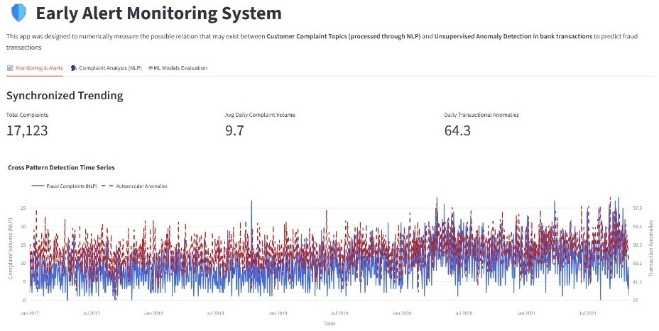

# Early Alert Monitoring System: Customer Complaints (NLP) vs. Transactional Fraud (Deep Learning)

An end-to-end Machine Learning & Deep Learning monitoring framework designed to quantify whether **Customer Complaint Topics (processed via NLP on CFPB text narratives)** act as a **leading indicator for transactional fraud and operational anomalies in banking systems**.

This project aims to measure the correlation between consumer complaints and fraudulent transactions by applying multiple Machine Learning algorithms to classify complaint topics, predict fraud incidence and anomaly detection based on complaints, to create a reproducible framework on this topic



## Data Governance and Timeframes Disclaimer:
Since oficial CFPB consumer narratives were deprecated after Release 24 (Sep. 2026) and deceptive practices are closely related to concept and time drifts, this project is developed using a coherent timeframe obtained for the most updated available file from Kaggle (2011-2022). The NLP architecture and pipeline are designed to match the source information, which allows retraining with transactional data in case the narratives can be upadted/increased in the future.

Since no information was obtained for the whole period, the distribution of the available portion was used to simulate complaint behavior. 

---

## 📌 Executive Summary & Business Impact

In modern retail banking and financial institutions, customer complaints (e.g., *"unauthorized transactions"*, *"failing authentication"*, *"suspicious charges"*) often spike right when new fraud attack vectors emerge. However, fraud detection pipelines typically operate in isolation from customer support datasets.

This project aims to bridge that gap by connecting unstructured text data with transaction logs:
1. **NLP Topic Modeling (BERTopic & Sentence-Transformers):** Converts raw complaint narratives into semantic clusters to identify fraud-related claims automatically.
2. **Unsupervised Anomaly Detection (Deep Learning Autoencoders):** Learns the latent manifold of legitimate transactions to detect novel ("zero-day") fraud schemes via Reconstruction Error (MSE).
3. **Cross-Correlation & Lag Analysis:** Evaluates whether temporal spikes in support complaints precede operational fraud surges, establishing a **leading indicator window** for risk teams.
4. **Interactive Monitoring Dashboard (Streamlit):** Serves as an executive control room to monitor real-time complaint volumes, anomaly rates, and model performance metrics.

---

## 📌 Data Architecture & Storage Strategy

To adhere to MLOps best practices and avoid bloating the Git repository with large binary files, datasets are decoupled from code versioning:

* **Repository Scope:** Git tracks strictly source code, Jupyter notebooks, model configurations, and lightweight metadata.
* **Large Data Assets:** The raw and enriched datasets (`consumer_complaints.csv`, `creditcard_transactions.csv`) are hosted publicly on **Kaggle Datasets** under the project profile quoted at the end of this section.
* **Automated Data Pipeline:** The data loading script utilizes the `kaggle` API wrapper to check, download, and extract the required dataset seamlessly upon runtime.

```python
import os
from kaggle.api.kaggle_api_extended import KaggleApi

def load_dataset():
    data_path = "data/raw_data/consumer_complaints.csv"
    if not os.path.exists(data_path):
        print("Fetching dataset from Kaggle...")
        api = KaggleApi()
        api.authenticate()
        api.dataset_download_files("your-kaggle-username/your-dataset-repo", path="data/processed/", unzip=True)

Complaints Dataset: https://www.kaggle.com/datasets/justonenicolas/consumer-complaints-2011-2022
Transactions Dataset: https://www.kaggle.com/datasets/justonenicolas/credit-card-transactions 
```

---

## 💻 Streamlit Dashboard Preview

The interactive Streamlit application (`app/main.py`) provides three analytical modules:

1. **Monitoring & Alerts (Synchronized Trending):** Real-time overlay of daily fraud complaint volumes against PyTorch Autoencoder anomaly counts.
2. **Complaint Analysis (NLP / BERTopic):** Interactive topic inspector, allowing risk managers to read actual customer narratives behind emergent fraud categories (e.g., `tickets_chase_seller_scam`).
3. **ML Models Evaluation:** Comparative PR-AUC curves and scatter distribution plots (`Predicted Fraud Probability` vs. `Calculated Anomaly Score`).

---

## 📊 Key Findings & Model Evaluation
- High-Precision Operating Zone: At strict Reconstruction MSE thresholds ($Recall \in [0, 0.22]$), the Autoencoder operates at 100% Precision, eliminating false positives for high-confidence fraud alerts
- Balanced Operating Zone: At $Recall \approx 0.60$, the Autoencoder maintains $\approx 0.50$ Precision (1 in 2 alerts is a confirmed fraud).
- Relative Behavior: The limited prediction capacity for this scenario shows that conventional ML algorythms (such as Isolation Forest) find problems when facing sophisticated fraud behavior that assimilates normal transactions. Although the Autoencoder variation shows a better performance, further development and fine tuning should be applied to improve the model capacities.
- Overall finding: Fraudulent transactions try to simulate normal ones as much as possible, reason why simple anomalies cannot be tagged as fraud without further investigation.
